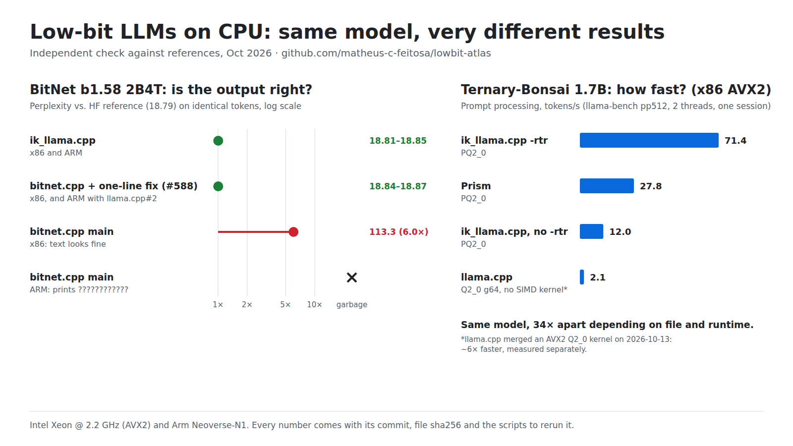

# Low-bit LLMs on CPU: what runs correctly and fast where (Oct 2026)

By [Matheus C. Feitosa](https://github.com/matheus-c-feitosa) · October 2026

> **First edition, October 2026.** Measured, and reproduced from scratch with the scripts in this repository, on aarch64 (Neoverse-N1) and x86-64 (Intel Xeon, AVX2). Last updated 2026-10-18 ([changelog](#changelog)).

An independent check of low-bit (1-bit, ternary, 2-bit) LLM files on CPU. For each file, runtime and CPU class, it answers two questions: **does the output match a reference, and how fast is it?** Every number comes with the runtime commit, file sha256, CPU and flags (`results/`); `scripts/` rebuilds and reruns the main measurements.



*Drawn from `results/` by `scripts/chart.py`.*

## What to use today

At the commits measured (October 2026). Runtimes move fast; the linked issues may have changed.

| Model | Use | Avoid |
|---|---|---|
| **BitNet b1.58 2B4T** | **ik_llama.cpp**, after converting the file once: `llama-quantize --allow-requantize ggml-model-i2_s.gguf out.gguf iq2_bn_r4`. Correct on x86-64 and aarch64. In bitnet.cpp: isHuangXin/llama.cpp#2 + [#605](https://github.com/microsoft/BitNet/pull/605), run with `--override-kv bitnet-b1.58.hidden_activation=str:relu2`. Correct on both CPUs ([details](#bitnet-b158-2b-4t-which-fix-actually-works)) | **bitnet.cpp main as published** (`0b341e5`, still the latest): wrong output on CPU, ~6× the reference perplexity on x86-64 and `????` on aarch64 |
| **Bonsai-1.7B** (Q1_0) and **Ternary-Bonsai-1.7B** (Q2_0 g64, PQ2_0) | Any of llama.cpp, Prism and ik_llama.cpp: the output is correct wherever the file loads ([which file loads where](#bonsai-17b-prism-correct-everywhere-tested)). Fastest prompt processing with Q1_0 and PQ2_0: **ik_llama.cpp with `-rtr`**. For PQ2_0 generation on aarch64, Prism is faster | The Ternary `Q2_0.gguf` marked "recommended" on its model card: it loads in none of the three. On x86-64, Q2_0 g64 in Prism: generic C code, ~13× slower than PQ2_0 (llama.cpp has had an AVX2 kernel since `0a731cc`, ik_llama.cpp since `422c259`) |
| **Ternary-Bonsai-2 27B** (PQ2_0, PTQ1_0) | Prism or ik_llama.cpp (llama.cpp does not have these types yet). **ik_llama.cpp with `-rtr`** is ~2× faster than Prism on PQ2_0 (x86-64) | ik_llama.cpp without `-rtr`: prompt processing ~3× slower than Prism. On x86-64, PTQ1_0 in Prism: ~4× slower prompt processing and ~2.4× slower generation than PQ2_0, although the file is smaller (no fast path yet, [PrismML-Eng/llama.cpp#324](https://github.com/PrismML-Eng/llama.cpp/issues/324)) |

Measured on x86-64 with AVX2 and on aarch64 Neoverse-N1 only. On CPUs with AVX-512, loading PQ2_0 in Prism is reported to crash ([PrismML-Eng/llama.cpp#180](https://github.com/PrismML-Eng/llama.cpp/issues/180), not tested here). Other CPUs: [help wanted](#run-it-on-your-cpu-help-wanted).

## Key findings

1. **BitNet-b1.58-2B-4T: the official runtime (bitnet.cpp) gives wrong output on CPU, silently, and has done so for months.**
   - On x86-64 the text looks fine, but perplexity is ~6× the reference: the FFN uses SiLU where the model uses ReLU² ([microsoft/BitNet#588](https://github.com/microsoft/BitNet/issues/588), reported July 2026).
   - On aarch64 the output is garbage (`????`) since commit `112f853`, Nov 2025 ([#470](https://github.com/microsoft/BitNet/issues/470)).
   - Fixes have been proposed but **none is merged**. We tested them against a reference: on current main, **only the activation fix from #588 gives correct output** (plus isHuangXin/llama.cpp#2 on aarch64). It can be applied as a one-line change; through [#605](https://github.com/microsoft/BitNet/pull/605) plus a runtime key, safely for the other BitNet models; or with [#642](https://github.com/microsoft/BitNet/pull/642) in its third version (Oct 15), which bundles the one-line change with the same aarch64 kernel as llama.cpp#2 and is correct on our aarch64 and x86-64 machines, with static and shared-library builds. Two other proposed fixes do not reach the code that runs. See [BitNet](#bitnet-b158-2b-4t-which-fix-actually-works).
2. **The Bonsai family (Prism) runs correctly** in llama.cpp and the Prism fork on every CPU class tested, and in ik_llama.cpp where tested. The differences are in **speed** and in **which file loads where**: the file marked "recommended" on one model card does not load in any of the three runtimes.
3. **Speed depends on the format × CPU × runtime path, not on file size.** The smallest 27B file is ~4× slower to process prompts in Prism on AVX2 x86. ik_llama.cpp with `-rtr` is the fastest in most cases measured (not for PQ2_0 generation on aarch64), and `-rtr` is off by default: without it, ik_llama.cpp is often the slowest. On x86-64 at the measured commits, Q2_0 has no SIMD kernel at all, so the Ternary-Bonsai-1.7B Q2_0 g64 file processes prompts ~13× slower than its PQ2_0 version. llama.cpp merged an AVX2 kernel for it on 2026-10-13: measured before and after on the same VM, it is ~6× faster with unchanged accuracy. ik_llama.cpp added Q2_0 on the same day: also correct, and ~15× faster than Prism for prompt processing on x86-64.

## BitNet-b1.58-2B-4T: which fix actually works

Same official GGUF (`ggml-model-i2_s.gguf`, sha256 `4221b252…`) and the same 4,096 token IDs everywhere. WikiText-2, 8 × 512 windows. The reference is HF transformers (`BitNetForCausalLM`, float32) scoring the same token IDs. Greedy text continues "The capital of France is".

| Runtime / fix | CPU | Greedy text | PPL | vs reference |
|---|---|---|---|---|
| **HF transformers (reference)** | — | "Paris. Paris is a city in the Île-de-F…" | **18.79** | — |
| bitnet.cpp main (`0b341e5`) | x86-64 AVX2 | "a small city, and the capital of France is a small" | 113.33 | **6.0× — wrong** (same with gcc 13.3 and clang 18) |
| bitnet.cpp main | aarch64 | `????????????` | — | **garbage** |
| main + [isHuangXin/llama.cpp#2](https://github.com/isHuangXin/llama.cpp/pull/2) | aarch64 | "a small city, and…" | 113.26 | 6.0× — layout fixed, activation still wrong |
| **main + llama.cpp#2 + the one-line fix from [#588](https://github.com/microsoft/BitNet/issues/588)** | aarch64 NEON+dotprod | "Paris. Paris is a city that is known for its rich" | **18.84** | **+0.27% — correct** |
| **main + the one-line fix from #588** | x86-64 AVX2 | "Paris. Paris is a city that is known for its rich" | **18.87** | **+0.39% — correct** |
| main + llama.cpp#2 + the #588 line (same recipe as aarch64) | x86-64 AVX2 | same | 18.87 | identical to the line above: one recipe for both |
| main + llama.cpp#2 + [#605](https://github.com/microsoft/BitNet/pull/605), file as published | aarch64 | "a small city, and…" | — | still wrong: files without the activation key keep SiLU |
| **main + llama.cpp#2 + #605, run with `--override-kv bitnet-b1.58.hidden_activation=str:relu2`** | aarch64 / x86-64 | "Paris. Paris is a city that is known for its rich" | **18.84 / 18.87** | **+0.27% / +0.39% — correct**, identical to the one-line fix; files without the key keep SiLU |
| main + [#633](https://github.com/microsoft/BitNet/pull/633) | aarch64 | `????????????` | — | no effect: edits a file current main does not compile |
| main + [#642](https://github.com/microsoft/BitNet/pull/642), first version (`9dcd80d`, Oct 12) | aarch64 | `????????????` as merged; with its `.patch` applied by hand, "fits offend teaching ultimately…" | 51,732,149 (with the patch) | **garbage**: the patch was not applied by the build, and the kernel paired weights with the wrong activations |
| main + #642, second version (`241ce30`, Oct 14) | aarch64 NEON+dotprod | "Paris. Paris is a city that is known for its rich" | 18.84 | correct with a static build; with shared libraries, the default of `setup_env.py`, it does not link: `quantize_i2_s` and `ggml_vec_dot_i2_i8_s` are defined twice |
| **main + #642, third version (`4cdf35a`, Oct 15)** | aarch64 NEON+dotprod / x86-64 AVX2 | "Paris. Paris is a city that is known for its rich" | **18.84 / 18.87** | **+0.27% / +0.39% — correct**, with a static build and with the `setup_env.py` recipe (shared libraries). Per window, identical to the llama.cpp#2 + #588 line rows: same kernel, same activation fix |
| main + #642, third version, built with `-march=armv8-a` (no dotprod: the kernel's scalar path) | aarch64 ARMv8.0 (emulated on Neoverse-N1) | "Paris. Paris is a city that is known for its rich" | 18.85 | **+0.30% — correct**. The path a CPU without dotprod takes, such as the Raspberry Pi 4's Cortex-A72; real hardware not tested |
| [BitRun](https://github.com/IshekKhal/bitrun) v0.2 engine (`d00e6f155`: llama.cpp `843e7dcc1` + BitRun's patch, by the author of #642), gcc 13.3 | aarch64 NEON+dotprod | "Paris. Paris is a city that is known for its rich" | 18.84 | **+0.23% — correct**. Rebased on current llama.cpp, with ReLU² fixed in the bitnet graph: as with the one-line change, the 1bitLLM models would get it too (not tested). Built from source (the release has no Linux aarch64 binary); x86-64 not tested |
| [#586](https://github.com/microsoft/BitNet/pull/586) on its own base (`01eb415`, Mar 2026) | aarch64 | "Paris. Paris is a city…" | 18.85 | correct, but does not apply to current main (same reason) |
| bitnet.cpp `404980e` (June 2025) | aarch64 / x86-64 | "Paris. Paris is a city…" | 18.85 / 18.81 (clang), 18.84 (gcc) | correct (before the regression) |
| **ik_llama.cpp `04b4ebc`** (file converted to `iq2_bn_r4`, as [ik#387](https://github.com/ikawrakow/ik_llama.cpp/issues/387) documents) | aarch64 / x86-64 | "Paris. Paris is a city…" | **18.81 / 18.85** | **correct** |

All correct implementations land within +0.1–0.4% of the reference. A GGUF runtime quantizes activations to 8 bits and the reference runs in float32, so a small positive offset is expected. The wrong one is at +503%.

**Cross-check with the numbers published in #588.** We reran the protocol posted there by isaacmadine96-art (20 × 512 windows, `-t 4`) on our own x86-64 machine:

| Build | Their result | Ours |
|---|---|---|
| June 2025 (`765741d`; same build code as `404980e`) | 19.6002 ± 0.85043 | 19.6002 ± 0.85043 |
| current main (`16da220` = `0b341e5`) | 118.7272 ± 6.21259 | 118.7272 ± 6.21259 |
| June 2025, `tokenizer.ggml.pre=llama-bpe` | 16.7775 | 16.7775 |
| current main + #588 fix, `llama-bpe` | — | 16.7876 |

The results are identical to the fourth decimal on a different machine, so the two measurements confirm each other.

**What to use today:**

- **Easiest:** ik_llama.cpp. Convert the file once with `llama-quantize --allow-requantize ggml-model-i2_s.gguf out.gguf iq2_bn_r4`. Measured correct on aarch64 and x86-64.
- **bitnet.cpp, safe for every BitNet model:** apply #605 (on aarch64, also isHuangXin/llama.cpp#2), and run with `--override-kv bitnet-b1.58.hidden_activation=str:relu2`. Files without that key keep SiLU, so by design the older 1bitLLM models (`bitnet_b1_58-large`, `-3B`), which go through the same graph code and do use SiLU, should not be affected. Those models were not tested here. `scripts/build.sh bitnet-605` builds this. Measured on aarch64 (18.84) and x86-64 (18.87).
- **bitnet.cpp, quickest, but only for BitNet-b1.58-2B-4T:** the one-line change from #588 (`LLM_FFN_SILU` → `LLM_FFN_RELU_SQR` in `3rdparty/llama.cpp/src/models/bitnet.cpp`; on aarch64, plus isHuangXin/llama.cpp#2). It switches every model that goes through this graph code to ReLU², so **it breaks the 1bitLLM models**. That is why the same change was not accepted in llama.cpp, as discussed in #588. `scripts/build.sh bitnet-fixed` builds this. A narrower variant applies ReLU² only when `model.arch == LLM_ARCH_BITNET_B158 && model.type == LLM_TYPE_2B` (homeofe, #602); it was not tested here.
- **Tokenizer:** the published GGUF has no `tokenizer.ggml.pre`, so llama.cpp-based runtimes fall back to a default pre-tokenizer and produce ~16% more tokens than the HF tokenizer. `tokenizer.ggml.pre=str:llama-bpe` makes the tokenization match the model's own tokenizer (checked in #588). Perplexities on different tokenizations are not directly comparable (19.60 vs 16.78 in our rerun of the #588 protocol), so the tables above keep the default tokenization and score every runtime on identical tokens.
- **Pass all keys in one flag, comma-separated:** `--override-kv bitnet-b1.58.hidden_activation=str:relu2,tokenizer.ggml.pre=str:llama-bpe`. Repeating `--override-kv` prints a DEPRECATED warning ("only last value will be used"). In our tests with `llama-completion` and `llama-perplexity`, both values still applied (window-1 PPL 9.48 either way), but #602 reports that only the last one took effect in its setup.
- **For chat:** #602 (homeofe, paulanthonyhebbes-sudo) reports that the GGUF's built-in chat template is outdated (use the one in the model's `tokenizer_config.json`). With SiLU the model never emits `<|eot_id|>` and keeps going until the token limit; with ReLU² it stops normally. Not tested here.
- **Where this was tested:** aarch64 with NEON + dotprod (Neoverse-N1) and x86-64 with AVX2. Other platforms have separate open bitnet.cpp bugs that are not covered here: x86 without AVX2 (#547, #617), Arm with i8mm such as Apple M2 and later or Graviton3 (#618, a build failure), BLAS builds such as the macOS default (#601), and build failures on macOS (#611).

**Credit:**

- The ~6× perplexity and its cause were reported in microsoft/BitNet#588 by hmeiland, and confirmed there by several people.
- The aarch64 regression was bisected to `112f853` in microsoft/BitNet#470 by aqn96.
- That `ggml-bitnet-mad.cpp` had dropped out of the build was noted in #626.
- The metadata-based fix is #605, by praneshnikhar.
- The caveat that the one-line change breaks the 1bitLLM models, and the tokenizer finding, come from the #588 thread (purpleskulll, dondetir, isaacmadine96-art).

What this report adds is the comparison of the fixes against a reference on identical token IDs, on both aarch64 and x86-64, plus an exact reproduction of the numbers published in #588. Details: [`results/bitnet-b1.58-2b-4t.json`](results/bitnet-b1.58-2b-4t.json).

## Bonsai 1.7B (Prism): correct everywhere tested

Three formats (PQ2_0 does not load in llama.cpp) × five CPU classes × llama.cpp and the Prism fork, plus ik_llama.cpp on aarch64 NEON+dotprod and x86-64 AVX2. The CPU classes are aarch64 NEON+dotprod, aarch64 ARMv8.0, x86-64 AVX2, x86-64 AVX and x86-64 SSE.

- Kernel tests: `test-backend-ops` 0 failures (llama.cpp 310/310, Prism 833/833) in every class.
- Perplexity spread across classes and runtimes is ≤ 0.15%, within the spread between valid code paths (see [METHOD](METHOD.md#5-pitfalls-found-along-the-way)). Greedy text is identical everywhere.
- KL against an exact F16 reference puts llama.cpp, Prism and ik_llama.cpp at the type's natural spread, with the same pattern on aarch64 and x86-64 (Q1_0 ~2.1–2.5e-4, PQ2_0 ~0.75–1.0e-3). One case sits at the edge: ik_llama.cpp **with `-rtr`** on Q1_0 is ~2× farther than the best path (4.5e-4 on aarch64, same top-1 98.7%; 4.2e-4 on x86-64). It quantizes activations differently (`Q8_K128`). Greedy text is unchanged, and it is not counted as a divergence, but it is the closest to the line.

**Which file loads where:**

| File | llama.cpp | Prism | ik_llama.cpp |
|---|---|---|---|
| Bonsai-1.7B Q1_0 | ✔ | ✔ | ✔ |
| Ternary-Bonsai-1.7B Q2_0 g64 | ✔ | ✔ | ✘ at `04b4ebc` (no type 42); ✔ since `422c259` (update below) |
| Ternary-Bonsai-1.7B PQ2_0 | ✘ (type 142 unknown) | ✔ | ✔ |
| Ternary-Bonsai-1.7B **Q2_0 ("recommended" on the card)** | ✘ | ✘ (clear message: legacy layout) | ✘ |

The legacy Q2_0 file problem was already reported (PrismML-Eng/llama.cpp#167, Ternary-Bonsai-27B-gguf discussions #64/#65). The 1.7B card still recommends it at revision `983b5de`.

**Speed** (aarch64 Neoverse-N1, 2 threads, `llama-bench -p 512 -n 64 -r 3`, tokens/s):

| File | llama.cpp | Prism | ik_llama.cpp | ik_llama.cpp `-rtr` |
|---|---|---|---|---|
| Q1_0 | 51.8 / 14.1 | 51.7 / 14.2 | 34.9 / 14.2 | **72.0 / 23.3** |
| PQ2_0 | — | 15.3 / 11.1 | 6.4 / 1.8 | **68.5** / 8.1 |

**Speed** (x86-64 Intel Xeon @ 2.2 GHz, AVX2, hosted VM with 4 vCPUs, 2 threads, same `llama-bench` command, tokens/s):

| File | llama.cpp | Prism | ik_llama.cpp | ik_llama.cpp `-rtr` |
|---|---|---|---|---|
| Q1_0 | 22.5 / 16.0 | 38.4 / 18.3 | 31.2 / 17.3 | **75.9 / 23.6** |
| Q2_0 g64 | 2.1 / 1.6 | 2.1 / 1.6 | — | — |
| PQ2_0 | — | 27.8 / 12.9 | 12.0 / 12.9 | **71.4 / 17.3** |

On x86-64 at these commits, llama.cpp has no repacked path for Q1_0, while Prism does. Neither runtime has a SIMD kernel for Q2_0 at these commits: it runs generic C code, ~13× slower than PQ2_0.

**Update, 2026-10-13:** llama.cpp merged an AVX2 Q2_0 kernel (ggml-org/llama.cpp#30447, `0a731cc`). Measured at that commit and at its parent (`f851e24`), in one session on the same kind of VM (Intel Xeon @ 2.2 GHz, AVX2 + FMA, no AVX-512, gcc 13.3, 2 threads):

| Q2_0 g64 in llama.cpp | Speed, tokens/s (prompt / generation) | KL vs exact F16 | Same top-1 | Greedy text |
|---|---|---|---|---|
| before: generic C | 1.77 / 1.41 | 2.32e-4 | 99.1% | "Paris. The capital of France is Paris" |
| after: AVX2 kernel | **11.3 / 8.5** (6.4× / 6.0×) | 2.27e-4 | 99.2% | same |

- **The kernel is correct:** KL is unchanged, the text is the same, and the PPL moved by −0.05% (18.3723 → 18.3632).
- **It is ~6× faster end to end.** Its author reported 8–9× on the matrix multiplication alone, on AMD Zen 2. The end-to-end numbers also include the other operations.
- **Compare speeds within one session only:** this session ran ~15% slower than the table above (1.77 vs 2.1 before the kernel).
- The F16 reference is converted from the Q2_0 g64 file itself. The conversion is exact, because the file holds only Q2_0 and F32 tensors.
- The commits pinned in `scripts/` predate the kernel, so the Q2_0 row in the table above is the generic path.
- **Prism does not have this kernel yet** (read in the code of its `prism` branch at `e3de715`, 2026-10-14; not measured). Q2_0 still runs generic C code there on x86, with or without AVX-512 (its AVX-512 repacked path is for PQ2_0 only). Prism and llama.cpp ran Q2_0 at the same speed before the kernel (2.1 / 1.6), so on x86 a Q2_0 g64 file should run ~6× faster in llama.cpp from `0a731cc` than in Prism. The same model in PQ2_0 is still faster (speed table above): 27.8 / 12.9 in Prism, 71.4 / 17.3 in ik_llama.cpp with `-rtr`.

**Update, 2026-10-18:** ik_llama.cpp added Q2_0 ([ikawrakow/ik_llama.cpp#2659](https://github.com/ikawrakow/ik_llama.cpp/pull/2659), `422c259`, 2026-10-13): blocks of 64 with the same type id as llama.cpp, and AVX2 and NEON kernels. Measured at `c446f1e` (main on 2026-10-17), with Prism `6bfcd79` in the same session, 2 threads, on aarch64 Neoverse-N1 (clang 18) and on the same kind of x86-64 VM (Intel Xeon @ 2.2 GHz, AVX2 + FMA, no AVX-512, gcc 13.3):

| Q2_0 g64 in ik_llama.cpp `c446f1e` | aarch64 | x86-64 |
|---|---|---|
| Speed, tokens/s (prompt / generation) | **34.1 / 13.3** (Prism: 13.0 / 10.0) | **31.0 / 10.6** (Prism: 2.1 / 1.6) |
| KL vs exact F16, same top-1 | 2.60e-4, 99.1% (Prism: 2.34e-4, 98.7%) | 2.38e-4, 99.1% (llama.cpp: 2.27–2.32e-4) |
| PPL, 8 windows | 18.3462 (Prism: 18.3733) | 18.386 (llama.cpp and Prism: 18.3707) |
| Greedy text | "Paris. The capital of France is Paris" | same |

- **Correct on both CPUs:** the text is the same, the PPL is within 0.15% of the other runtimes, and the KL is 1.0–1.1× theirs, within the type's natural spread.
- **On x86-64 it is ~15× faster than Prism for prompt processing and ~6.6× for generation**, because Prism still runs generic C code for Q2_0. On aarch64: 2.6× and 1.3×.
- **PQ2_0 is still the fastest file on x86-64.** In the same session it ran at 71.7 / 21.9 in ik_llama.cpp with `-rtr` (2.3× / 2.1× the Q2_0 g64 file) and at 28.8 / 13.8 in Prism.
- llama.cpp's AVX2 kernel (update above) was measured in another session, so it is not compared here.
- `-rtr` changes nothing for Q2_0 on aarch64: same PPL and speed, as there is no repacked type. Not measured on x86-64.
- The legacy Q2_0 file still does not load.
- ik_llama.cpp logs `unknown type q2_0` and labels the file `Q1_0_G128`. That is cosmetic: `general.file_type` 41 means Q2_0 in llama.cpp and Prism, and Q1_0_G128 in ik_llama.cpp.
- The ik_llama.cpp commit pinned in `scripts/` (`04b4ebc`) predates Q2_0. At `c446f1e`, the ik_llama.cpp numbers of `run.sh check` are unchanged: all of them on aarch64, and the two measured on x86-64. Details: `ik_q2_0_main` in [`results/bonsai-1.7b.json`](results/bonsai-1.7b.json).

## Ternary-Bonsai-2 27B (Prism): correct, speed depends on the file

- PTQ1_0 aarch64 vs x86-64: PPL within 0.03%.
- ik_llama.cpp vs Prism on PQ2_0 (x86-64): KLD 2.1e-4 with `-rtr` (same top-1 99.2%), 2.6e-4 without (98.8%). 2 windows only.
- PTQ1_0 and PQ2_0 hold bit-identical weights (PrismML-Eng/llama.cpp#148). In ik_llama.cpp with `-rtr` they give the same PPL to every printed digit. In Prism the PPL differs slightly (8.7507 vs 8.7515), presumably because each type has its own kernel.
- On AVX2 x86-64, PTQ1_0 is ~4.4× slower than PQ2_0 in Prism for prompt processing and ~2.4× slower for generation (`llama-bench -p 128 -n 32 -t 4 -r 2`, both files in one session on 2026-10-14: 0.45 vs 1.98 tokens/s prompt, 0.40 vs 0.97 generation). Its prompt processing runs at about generation speed: there is no repacked path (PrismML-Eng/llama.cpp#324). An earlier estimate from `llama-completion` timings said ~6×.
- ik_llama.cpp with `-rtr` is ~1.9–2.1× (prompt) and ~2.3–2.4× (generation) faster than Prism on PQ2_0, in two sessions. Without `-rtr`, prompt processing is ~3.1–3.5× slower.
- **Update, 2026-10-11:** llama.cpp merged support for this model's architecture (the Hadamard rotation; ggml-org/llama.cpp#29600), but not the PQ2_0/PTQ1_0 types (`master` still has 43 ggml types). The published 27B files therefore still need the Prism fork or ik_llama.cpp.
- ik_llama.cpp labels this PQ2_0 file "IQ5_K". That is cosmetic: `general.file_type` 141 means PQ2_0 in Prism and IQ5_K in ik_llama.cpp.

## How it was measured

See [METHOD.md](METHOD.md): protocol, the two kinds of reference, what counts as a divergence, and seven pitfalls.

## Reproduce

**In the browser, on a free x86-64 VM:** [open the notebook in Kaggle](https://www.kaggle.com/kernels/welcome?src=https://github.com/matheus-c-feitosa/lowbit-atlas/blob/main/notebooks/reproduce.ipynb) (turn on Internet in its settings) or [in Colab](https://colab.research.google.com/github/matheus-c-feitosa/lowbit-atlas/blob/main/notebooks/reproduce.ipynb). By default it runs the short check (`run.sh check`: about 30 min on Kaggle's 4 vCPUs, about 1 h on Colab's free 2 vCPUs): it builds Prism and ik_llama.cpp, checks Bonsai 1.7B and BitNet b1.58 2B4T against the published numbers, and prints a summary to share. `MODE=quick` runs everything (about 40 min of builds and 3 h of measurements).

**On your own Linux machine:**

```bash
WORK=$PWD/work scripts/build.sh all     # llama.cpp, Prism, ik_llama.cpp, 3 bitnet.cpp variants
WORK=$PWD/work scripts/run.sh quick     # BitNet + Bonsai 1.7B; "full" adds the 27B (>= 16 GB RAM)
                                        # "27b" runs only the 27B part (needs prism and ik)
                                        # "check": a ~30 min subset (needs prism and ik)
scripts/compare.py work/results.jsonl   # SAME / CLOSE / DIFFERS vs the numbers published here
python3 -m unittest discover tests     # checks of the scripts themselves (seconds, no downloads)
```

Every input is pinned: runtime commits, model files (revision and sha256) and WikiText-2. `run.sh` records each measurement with the CPU, the runtime and submodule commits, and the flags.

**Reproduced from scratch on aarch64** (Neoverse-N1, clang 18, 2026-10-11): all builds, then `run.sh quick` in about 2 h. Result: **43 of 43** comparable measurements came out SAME (greedy text, perplexity, KL, which file loads where). Speed is not judged: prompt processing came within 2.5% of the published numbers, generation within 10%.

**The short check, from scratch on aarch64** (`build.sh prism ik` then `run.sh check`, Neoverse-N1, clang 18, 2026-10-14): 16 min of builds and 16 min of measurements on 2 cores. **10 of 10** comparable measurements came out SAME. With gcc 13.3 instead (Ubuntu's default), the same check gives 8 SAME and 2 CLOSE (Prism PQ2_0 −0.07%, ik_llama.cpp BitNet +0.16%), within the spread between valid code paths.

**The short check through the notebook, on Kaggle** (Intel Xeon @ 2.2 GHz, 4 vCPUs, gcc 13.3, 2026-10-14): 15 min of builds and 14 min of measurements. **10 of 10** SAME.

**Reproduced from scratch on x86-64** (hosted VM, Intel Xeon @ 2.2 GHz, gcc 13.3, right after publication): 32 SAME, 3 CLOSE, 0 DIFFERS, plus 13 measurements that were new on x86-64 and are now part of `compare.py`. The 3 CLOSE are within the spread between valid code paths:

- Q2_0 g64 in llama.cpp and Prism gave 18.3723, against 18.3707 on the AMD EPYC used before. On x86-64 this type runs generic C code, which the compiler vectorizes differently for each CPU.
- bitnet.cpp June 2025 gave 18.8431 with gcc, against 18.8137 with clang.

**The 27B part, reproduced from scratch on x86-64** (Intel Xeon @ 2.2 GHz, gcc 13.3, `run.sh 27b`, 2026-10-14): about 15 min of builds and 2 h of measurements on a 4-vCPU VM. **5 of 5** perplexity and KL values came out SAME. Speed is not judged; the ratios between runtimes moved by up to 16% (see the 27B section).

- The greedy-text check first said DIFFERS. That was a bug in `compare.py`, not in the model: the 27B ends each sentence with a newline, and the expected text had been stored without them. Fixed.
- The text was then generated again, with the same function, on another x86-64 VM (AMD EPYC 7B12): both files gave text byte-identical to aarch64. On the Xeon, the run's summary was cut at 150 columns; the text matched up to that point ("…The capital of Spain is M").
- `quick` and `27b` together are `full`. On x86-64 they ran in separate sessions.

## Run it on your CPU (help wanted)

Measured so far: x86-64 with AVX2 (Intel Xeon, AMD EPYC) and aarch64 Neoverse-N1. **Not measured yet**, and the most useful:

- x86-64 with AVX-512 or AVX-VNNI (Intel Sapphire Rapids and later, AMD Zen 4/5)
- Arm with i8mm or SVE (AWS Graviton3/4, Neoverse V/N2, Snapdragon X)
- Raspberry Pi 5 and other Cortex-A76 boards
- Apple Silicon (M1–M5). The scripts are Linux-only so far; a macOS port is welcome.

Run the notebook or the commands above, then [share your results](https://github.com/matheus-c-feitosa/lowbit-atlas/issues/new?template=results.yml). New CPU classes go into the report, with credit.

## Feedback

Found an error, or have a CPU, runtime or model file that is not covered here? Please open an issue in this repository. Include the runtime commit, the CPU (`lscpu` on Linux), the file, and the exact command and output. Corrections are especially welcome: if one of the linked fixes gets merged, or a number here does not reproduce, the report will be updated and the change credited.

## Changelog

The full history is in the commit log.

- **2026-10-18**
  - Fixed in `scripts/`: `compare.py` reported a KL measurement that gave no number (a crash, or `-nan`) as NEW instead of DIFFERS, and stopped with an error on `nan`. Each record now carries the runtime's exit code, so a crash shows up as one. Also: a mean KLD below zero is now read; if a results file holds the same label twice, the last run counts; rerunning the notebook cell starts a new results file. The published numbers do not change.
  - Added: `tests/`, checks of the scripts themselves (a few seconds, no downloads).
  - Added: the short check on aarch64 with gcc 13.3 instead of clang 18: 8 SAME and 2 CLOSE ([Reproduce](#reproduce)).
  - Added: Q2_0 in ik_llama.cpp (ik#2659), measured at `c446f1e` on aarch64 and x86-64: correct, and ~15× faster than Prism for prompt processing on x86-64 ([Bonsai section](#bonsai-17b-prism-correct-everywhere-tested)).
  - Clarified: PQ2_0 loads in Prism and ik_llama.cpp, not in llama.cpp; in `results/bonsai-1.7b.json`, KL on x86-64 is in `x86_reproduction` (the first matrix measured it on aarch64 only).
- **2026-10-16**
  - Added: the BitRun v0.2 engine (IshekKhal, the author of #642), rebased on current llama.cpp: correct on aarch64 (18.84 on the same token IDs; identical in a second session).
- **2026-10-15**
  - Added: microsoft/BitNet#642, third version: correct on aarch64 and x86-64, with static and shared-library builds, and on the scalar path for CPUs without dotprod (ARMv8.0 build).
  - Chart: the slowest bar is now Prism's Q2_0 g64, which still has no SIMD kernel on x86-64 (same session as the other bars). llama.cpp has had an AVX2 kernel for it since 2026-10-13.
  - Notebook tested on Colab's free CPU runtime (2 vCPUs, gcc 13.3): the short check matches all 10 published values, in about 1 h.
  - Clarified: `scripts/` reruns the main measurements, not every number in the report (the checks of open BitNet pull requests were run by hand).
- **2026-10-14**
  - **Correction:** in Prism on AVX2 x86-64, the 27B PTQ1_0 file is ~4.4× slower than PQ2_0 for prompt processing and ~2.4× for generation, remeasured with `llama-bench` with both files in one session. The first edition said ~6×, from `llama-completion` timings. The correction was also posted where the old number had been shared ([Ternary-Bonsai-27B-gguf #51](https://huggingface.co/prism-ml/Ternary-Bonsai-27B-gguf/discussions/51#6acfebf1739131619819a7f8)).
  - Added: [What to use today](#what-to-use-today); `run.sh check` (a ~30 min subset with the same protocol) and a browser notebook for Kaggle or Colab; a [results form](https://github.com/matheus-c-feitosa/lowbit-atlas/issues/new?template=results.yml) for new CPUs.
  - Added: microsoft/BitNet#642, both versions, on aarch64 (below).
  - The 27B part reproduced from scratch on x86-64: 5 of 5 SAME.
- **2026-10-13**
  - x86-64 reproduction from scratch: 32 SAME, 3 CLOSE, 0 DIFFERS.
  - Q2_0 on x86-64: the new AVX2 kernel in llama.cpp (ggml-org/llama.cpp#30447) measured before and after.
- **2026-10-11:** first edition, reproduced from scratch on aarch64 (all 43 comparable measurements SAME).

**Follow-ups in other projects.** What changed after a result from this report was posted there. A follow-up is not a merge: check the links for the current state.

- **microsoft/BitNet#642** (IshekKhal): the first version had no effect on aarch64 as it would be merged, and gave garbage with its patch applied ([test](https://github.com/microsoft/BitNet/pull/642#issuecomment-6173981334)). The second version (`241ce30`) was correct on aarch64 with a static build, but did not link with shared libraries, the default of `setup_env.py` ([retest](https://github.com/microsoft/BitNet/pull/642#issuecomment-6176911694)). The third version (`4cdf35a`) is correct on aarch64 and x86-64, with both builds, and on the scalar path of an ARMv8.0 build ([retest](https://github.com/microsoft/BitNet/pull/642#issuecomment-6196208436)). Not merged.
- **BitRun** (IshekKhal): its [patches README](https://github.com/IshekKhal/bitrun/blob/main/patches/README.md) credits the tests posted in #642 for two of the bugs it lists. The v0.2 engine is correct on aarch64 (BitNet table above).
- **microsoft/BitNet#633** (uno-km): updated after the first test (`899b738`). The [retest](https://github.com/microsoft/BitNet/pull/633#issuecomment-6097867561) still printed `????` on aarch64: the file it changes is not compiled on current main. Not merged.
- **ikawrakow/ik_llama.cpp#2651:** the maintainer recommended `-DGGML_NATIVE=OFF -DGGML_ARCH_FLAGS=-mcpu=native` for clang on aarch64. `build.sh` has used it since 2026-10-13, with identical results.

## Limitations

- One file per format, 512-token context, English text, 8 windows (2 for the 27B model).
- Real hardware: aarch64 Neoverse-N1 and x86-64 AVX2 (Intel Xeon @ 2.2 GHz, AMD EPYC 7B12). The older classes were emulated with build flags.
- No GPU, AVX-512, Arm i8mm/SVE or Apple Silicon.
- KL against an exact reference: Bonsai 1.7B on aarch64 and x86-64; 27B only between runtimes (x86-64). For BitNet, only PPL was compared with the HF reference, not KL.
- Runtimes move fast: the linked issues may have changed since October 2026.

## AI assistance

This work was done with the help of Claude Code (Anthropic), an AI coding assistant. It drafted scripts and text, helped analyze logs, and ran many of the measurements on the author's machines under the author's direction. The author reviewed every number against the logs and is responsible for the content. The AI is not an author. Commits made with its help carry an `Assisted-by:` trailer.

## License

- Scripts in `scripts/`: [Apache-2.0](LICENSE).
- Report text, tables and data in `results/`: [CC BY 4.0](LICENSE-CC-BY-4.0.txt).
- No model weights or third-party runtime code are redistributed here. The scripts download them from their original repositories, under their own licenses.
